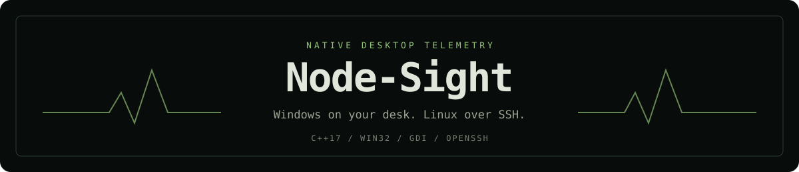
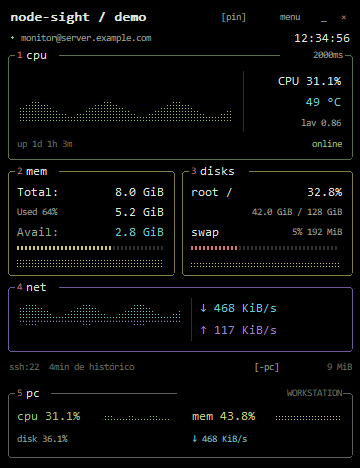
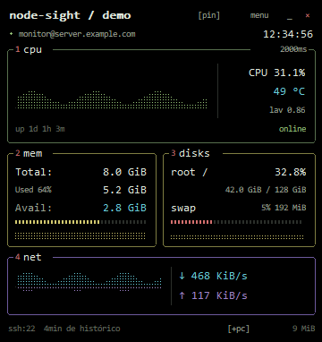

<p align="center">
  
</p>

<p align="center">
  <a href="https://github.com/Liveira/Node-Sight/actions/workflows/windows.yml"></a>
  
  
  <a href="LICENSE"></a>
</p>

<p align="center"><strong>A compact Windows desktop widget for your PC and a Linux server over SSH.</strong><br>Real system counters, terminal-style graphs and a persistent connection in a small native application.</p>

<p align="center">
  <a href="#preview">Preview</a> · <a href="#quick-start">Quick start</a> · <a href="#performance">Performance</a> · <a href="#configuration">Configuration</a> · <a href="docs/ARCHITECTURE.md">Architecture</a> · <a href="CONTRIBUTING.md">Contributing</a>
</p>

## Preview

| Server + optional PC panel | Server-only widget |
| :---: | :---: |
|  |  |
| 360 × 468 at 100%, 96 DPI | 360 × 382 at 100%, 96 DPI |

These images come from the **actual Win32/GDI renderer**, using deterministic **synthetic telemetry and anonymous labels**. They contain no real server address, account name or computer name. Desktop transparency is composited by Windows at runtime and is not shown in these exports.

## What it does

- Monitors Linux CPU, RAM, root-volume space, swap, network traffic, uptime, one-minute load and an available thermal sensor.
- Adds an optional local-PC panel with Windows CPU, RAM, system-volume space and network traffic.
- Draws fixed-length histories in a btop-inspired terminal layout: black background, fine borders and colored dot graphs.
- Runs as a desktop tool window, **without a taskbar or Alt+Tab entry**; use its notification-area icon or desktop shortcut to reopen it.
- Supports pinning above other apps, adjustable opacity, three sizes and configurable sampling intervals.
- Recovers automatically from failed SSH sessions and restarts a connected collector that stops delivering samples.
- Uses one persistent OpenSSH connection and an embedded read-only collector. **Nothing is installed on the Linux server.**

The executable uses C++17, Win32 and GDI. There is no browser engine, bundled interpreter, web server, metrics database, continuous animation loop or analytics service.

## Quick start

### Requirements

| Component | Requirement |
| --- | --- |
| Desktop | Windows 10/11 x64 |
| SSH client | Windows OpenSSH Client optional feature |
| Server | Linux with readable `/proc`, POSIX `sh`, `awk`, `df`, `grep` and `sleep` |
| Permissions | A normal SSH account; no sudo needed for the standard collector |
| Development only | Visual Studio 2022/2026 Desktop C++, Windows SDK and CMake with support for that generator |

### Get and run

Download a portable build from [Releases](https://github.com/Liveira/Node-Sight/releases), or use the build artifact from a successful [Windows workflow](https://github.com/Liveira/Node-Sight/actions/workflows/windows.yml). To build yourself, see the next section.

Keep these files together:

```text
NodeSight.exe
node-sight-askpass.exe
```

Run `NodeSight.exe`. Open **menu → Configurar conexão...** and enter your host, SSH user, port and optional private-key path. With an empty key path, normal OpenSSH defaults and `ssh-agent` remain available. Password authentication is optional and uses Windows Credential Manager.

The public defaults are deliberately neutral: `monitor@server.example.com:22`. **Configure your own destination before expecting server data.** A new checkout never targets the author's private network.

### Build from source

```powershell
git clone https://github.com/Liveira/Node-Sight.git
cd Node-Sight
.\build.ps1
Start-Process .\dist\NodeSight.exe
```

The script detects Visual Studio 2022/2026, builds x64 Release, runs CTest and stages the two executables in `dist`. Close a running copy before replacing its executable. The static C++ runtime avoids requiring a separate VC redistributable installation.

Manual CMake workflow (CMake 3.22+ for VS 2022; newer VS generators require a CMake version that supports them):

```powershell
cmake -S . -B build -A x64
cmake --build build --config Release --parallel
ctest --test-dir build -C Release --output-on-failure
cmake --install build --config Release --prefix dist
```

## Controls

The existing compact UI uses mainly Portuguese labels; metric abbreviations follow terminal conventions.

| Control | Action |
| --- | --- |
| Drag the left header | Move the widget; position is saved |
| `[pin]` / `[fixo]`, or **P** | Toggle always-on-top |
| `menu`, or right-click | Open native settings and preferences |
| `_` | Hide to the Windows notification area |
| Tray icon double-click | Restore the widget |
| `×` | Exit and close the SSH session |
| `[-pc]` / `[+pc]` | Hide/show the local-PC panel |
| **R** | Reconnect now |
| **Ctrl+,** | Open the connection dialog |

Keyboard shortcuts apply while the widget has focus. If the tray icon is hidden by Windows, find it in the notification-area overflow or launch the desktop shortcut; the single-instance guard restores the existing widget.

### Menu options

| Setting | Choices | Default |
| --- | --- | --- |
| Sampling interval | 1, 2, 5 or 10 seconds | 2 seconds |
| Opacity | 70%, 85%, 94% or 100% | 94% |
| Widget size | 80% mini, 100% compact, 125% enlarged | 100% |
| PC panel | On / off | On |
| Always on top | On / off | Off |

Size scales with monitor DPI and is clamped to fit the work area. Each series holds 120 points: **4 minutes at the default interval**, up to 20 minutes at 10 seconds. Graphs fill with real samples over time; missing history is not fabricated.

### Desktop and login shortcuts

From the source folder:

```powershell
.\create-shortcut.ps1                  # Desktop shortcut
.\create-shortcut.ps1 -Startup         # Start when this user signs into Windows
.\create-shortcut.ps1 -Startup -Remove # Disable that login shortcut
```

These are per-user shortcuts and require no administrator rights. A fresh download does not silently add itself to startup. Keep the application folder in a stable location after creating a shortcut.

## Metrics and interpretation

| Metric | Meaning and source |
| --- | --- |
| CPU | Interval change in idle/total CPU time, aggregated across the reported processors |
| RAM | Physical total minus available; Linux cache reclaimability follows `MemAvailable` |
| Root/system disk | Occupied capacity of `/` on Linux and the Windows installation volume locally |
| Swap | Linux used swap and percentage; not Windows pagefile accounting |
| RX / TX | Cumulative interface byte deltas divided by monotonic client elapsed seconds |
| Uptime | Boot-relative time; Windows Fast Startup can preserve the underlying boot session |
| Load | Linux one-minute load average, **not a CPU percentage** |
| Temperature | Preferred CPU thermal zone, otherwise the first readable zone; `n/d` when unavailable |

Disk graphs show **space usage, not disk I/O speed**. Remote disk capacity is refreshed every fifteen samples. Linux network selection prefers the default route; Windows prefers active physical adapters. Complex VPN, bridge or multihomed routing can affect what an aggregate means. CPU and network rates need two consecutive samples.

GPU, per-core/process tables, containers, all mounted filesystems, SMART, fan control and historical persistence are outside the current scope. Unavailable sensors are shown as unavailable rather than inferred.

## Performance

Measured on an **AMD Ryzen 7 5800X / 16 logical processors / approximately 16 GiB RAM / Windows 11 Pro**, with a real persistent LAN SSH session. Each scenario had a five-second warm-up followed by sixty one-second memory samples.

| Scenario | Widget avg. working set | SSH avg. working set | Sum | Sum private memory | Sum CPU, whole machine |
| --- | ---: | ---: | ---: | ---: | ---: |
| 1 s · PC on · 125% | 15.590 MiB | 11.484 MiB | **27.074 MiB** | 5.299 MiB | 0.04649% |
| 2 s · PC on · 100% | 15.573 MiB | 11.492 MiB | **27.065 MiB** | 5.305 MiB | 0.01122% |
| 5 s · PC off · 80% | 15.596 MiB | 11.496 MiB | **27.092 MiB** | 5.408 MiB | 0.00481% |

Working-set sums may count shared pages twice; private committed memory is a different measure. These short observations do not establish a fixed footprint, statistical confidence, battery impact or long-term leak freedom. **The slower mode used less CPU here; measured RAM stayed essentially the same.** The on-screen memory number covers only the widget, while this table includes SSH separately.

Read the [full methodology, limitations and raw reports](docs/PERFORMANCE.md). Reproduce with:

```powershell
.\tools\measure.ps1 -Seconds 60 -Label 'my-run' -OutputPath "$PWD\build\my-run.json"
```

## Configuration

Preferences live at `%LOCALAPPDATA%\NodeSight\settings.ini`. See [the safe example](examples/settings.ini). It stores connection coordinates and visual choices, **never passwords**. The private prototype's existing settings are migrated when the new settings file does not yet exist.

```ini
[widget]
host=server.example.com
user=monitor
port=22
key=
interval=2
opacity=94
size=100
local=1
pinned=0
```

Use the dialog to save/remove an optional password. Credentials are namespaced by SSH user, host and port. OpenSSH uses its normal `known_hosts`: first-use keys are accepted, changed known keys are rejected. Verify first-use fingerprints yourself when that assurance is needed; see [security and privacy](SECURITY.md).

## Testing and diagnostics

The Release-safe regression suite covers ring-buffer ordering, wire parsing, KiB conversion, first-sample behavior, CPU/network delta math, reboot resets, malformed frames and a real Windows collector read. It does not require a private server. [CI](.github/workflows/windows.yml) builds and runs that suite on Windows and uploads the portable binaries.

Additional live validation performed locally: Windows/Linux collection, native tool-window styles and automatic reconnect after terminating only an isolated probe's SSH child. These live checks depend on an individually configured host and are not part of public CI.

| Command | Purpose |
| --- | --- |
| `NodeSight.exe --probe` | Real collection smoke test; JSON to inherited stdout, nonzero exit on failure |
| `NodeSight.exe --window-info` | JSON description of the running widget's real styles and dimensions |
| `NodeSight.exe --demo-preview preview.bmp` | Anonymous full layout using synthetic telemetry, no SSH |
| `NodeSight.exe --demo-server-preview preview.bmp` | Anonymous server-only layout, no SSH |
| `NodeSight.exe --render-preview live.bmp` | Live rendering export; **can contain personal connection identities** |

Because the app uses the GUI subsystem, capture diagnostic output explicitly:

```powershell
Start-Process .\dist\NodeSight.exe -ArgumentList '--probe' -WindowStyle Hidden -Wait -RedirectStandardOutput .\build\probe.json
Get-Content .\build\probe.json
```

## Troubleshooting

| Symptom | Check |
| --- | --- |
| Offline on first launch | Replace the example host/user; confirm `ssh user@host` works in your own terminal |
| OpenSSH missing | Enable the Windows **OpenSSH Client** optional feature |
| Permission denied | Check user, port, key path, key permissions or the saved password |
| Changed host-key warning | Verify the host's identity before updating your normal `known_hosts` |
| Temperature is `n/d` | The account/kernel does not expose a readable thermal zone; other metrics still work |
| Empty graphs just after launch | Wait for samples; rates need two points and the 120-point history fills gradually |
| Widget seems gone | Restore via tray double-click or launch the desktop shortcut |
| Executable cannot be replaced | Exit the running widget before building/staging a new version |

## Project map

```text
src/                 Native UI, settings, collectors, credential helper and resources
collectors/          Embedded read-only Linux shell script
tests/               Release-safe metric regressions
tools/               Reproducible performance measurement
examples/            Non-sensitive configuration example
docs/assets/         Vector header and anonymous native-rendered previews
docs/benchmarks/     Sanitized real client measurement reports
.github/workflows/   Windows build, tests and portable artifacts
```

See [architecture and the RV1 protocol](docs/ARCHITECTURE.md) for units, formulas, ownership and resource lifetimes. Code comments are in English and explain function contracts, data flow and non-obvious branches.

## Contributing and license

Please read [CONTRIBUTING.md](CONTRIBUTING.md) before changing the collectors or publishing screenshots. Keep personal settings, keys and diagnostics out of patches. Security-sensitive reports should follow [SECURITY.md](SECURITY.md).

Released under the [MIT License](LICENSE). The terminal visual direction is inspired by [btop](https://github.com/aristocratos/btop); this project uses its own Win32/GDI implementation.
