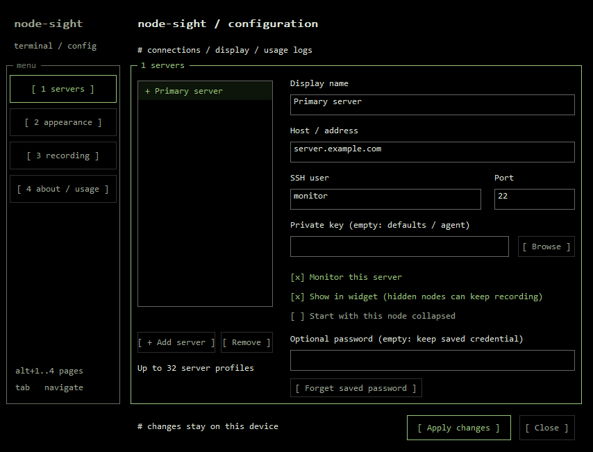
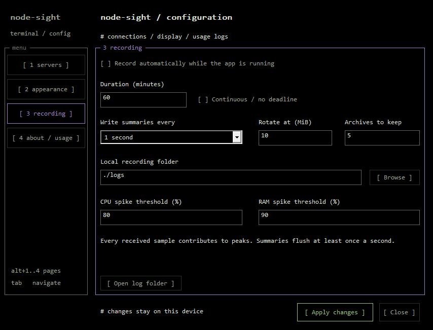
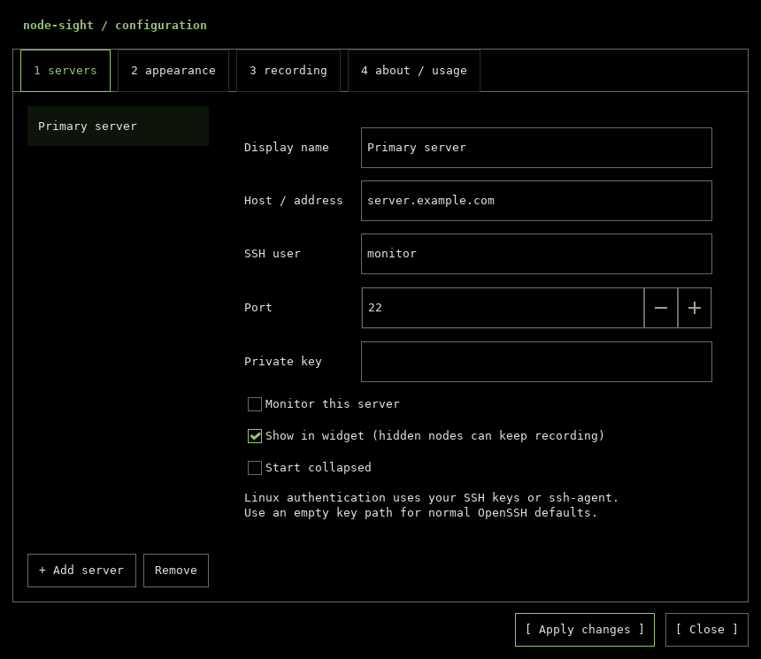
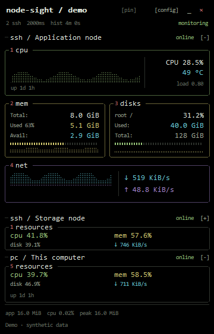
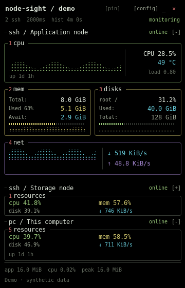

# Node-Sight

<p align="center">
  
  
  
  <a href="LICENSE"></a>
</p>

<p align="center"><strong>Monitor your computer and multiple Linux servers in one native desktop widget.</strong><br>Independent SSH sessions, configurable density, subsecond sampling and bounded local peak recording.</p>

<p align="center"><a href="#preview">Preview</a> · <a href="#build-and-run">Build</a> · <a href="#multiple-servers">Servers</a> · <a href="#customize-the-widget">Customize</a> · <a href="#recording-and-usage-peaks">Recording</a> · <a href="#performance">Performance</a> · <a href="docs/ARCHITECTURE.md">Architecture</a></p>

> **2.0 development:** these features belong to the current working tree. The published 1.0 release is an older Windows-only, single-server version. Build this tree to use the new clients and features. No 2.0 release is implied by the old release downloads or CI badge.

## Preview

### Terminal-style settings



### Recording controls



<details>
<summary>Native Linux settings (GTK 3)</summary>



</details>

### Terminal panels, shared native rendering

| Windows · Win32/GDI | Linux · GTK 3/Cairo |
| :---: | :---: |
|  |  |

These are exports from the application's own native renderers using **synthetic telemetry and neutral identities**. Settings previews also use neutral profiles. They are layout examples, not performance measurements; they do not capture a user's desktop. Runtime transparency is composited by the desktop and is not shown here.

## Capabilities

- **Native desktop clients:** Win32/GDI on Windows, GTK 3/Cairo on Linux. All application labels are in English.
- **Multiple servers:** up to 32 profiles, with independent persistent SSH connections and reconnect handling.
- **Visibility without disconnecting:** hide a card or collapse it while monitoring and recording continue.
- **Adjustable information:** Minimal, Balanced and Detailed modes, graph toggles and individual metric visibility.
- **Subsecond collection:** 100, 250 and 500 ms, plus 1, 2, 5 and 10 seconds.
- **Usage recording:** appendable `.log` files, finite or continuous sessions, timed peaks, threshold events and size-bounded rotation.
- **Useful consumption details:** absolute memory/disk capacity, network rates, observed host peaks, and app RSS/CPU/peak RSS.
- **Widget behavior:** tray controls, pinning, opacity, zoom and scrolling for long node lists.
- **Read-only server access:** the embedded collector is streamed over SSH; no agent, package or service is installed on the monitored Linux host.

The implementation uses a shared C++17 core and one system `ssh` process per enabled remote profile. Histories and pending recording queues are bounded. There is no browser engine, metrics database or continuous animation loop.

## Build and run

### Windows

Requirements: Windows 10/11 x64, Windows OpenSSH Client, Visual Studio 2022/2026 Desktop C++, Windows SDK and a CMake version supporting the installed generator.

```powershell
.\build.ps1
Start-Process .\dist\NodeSight.exe
```

Keep `NodeSight.exe` and `node-sight-askpass.exe` together. The helper is used only for optional Windows Credential Manager password authentication. With an empty key path, normal OpenSSH keys and `ssh-agent` are available. The C++ runtime is linked statically.

### Linux

Requirements: a GTK 3 graphical desktop, a C++17 compiler, CMake 3.22+, pkg-config and OpenSSH. Example development dependencies on Debian/Ubuntu:

```sh
sudo apt-get update
sudo apt-get install g++ make cmake pkg-config libgtk-3-dev librsvg2-common openssh-client
cmake -S . -B build -DCMAKE_BUILD_TYPE=Release
cmake --build build --parallel 2
ctest --test-dir build --output-on-failure
./build/NodeSight
```

Linux authentication currently uses **SSH keys or `ssh-agent`**; the Windows credential-helper/password UI is platform-specific. No plaintext password is saved in Linux preferences. Configure and test your key/agent in your own terminal first.

Optional user-level installation:

```sh
cmake --install build --prefix "$HOME/.local"
# Ensure ~/.local/bin is in PATH, or create a launcher with an absolute executable path:
sh tools/linux-shortcut.sh --desktop "$PWD/build/NodeSight"
```

GTK requests utility-window, skip-taskbar and keep-above hints. **X11 behavior was exercised under Xvfb. Wayland behavior depends on the compositor**, which may restrict positioning, global pinning, taskbar exclusion or tray integration. The tray is optional and may require a desktop extension; relaunching the application restores an existing normal desktop instance.

Remote monitoring targets are Linux systems exposing `/proc`, POSIX `sh`, `awk`, `df`, `grep` and `sleep` with fractional-second support. Native Windows is a desktop client/local monitor, not a Windows-over-SSH target collector.

## Multiple servers

Open **[config] → 1 servers** (or **Settings** in the context menu). Add a profile, choose a friendly display name, enter host/user/port and an optional private-key path, then **Apply changes**. Public defaults are deliberately neutral: `monitor@server.example.com`.

| Per-server setting | Effect |
| --- | --- |
| **Monitor this server** | Starts/stops that profile's SSH connection and collection |
| **Show in widget** | Changes presentation only; an enabled hidden profile still reaches recording |
| **Start collapsed** / card `−` / `+` | Keeps a compact summary instead of the expanded card |
| **Display name** | Friendly label used by the UI and log, independent of SSH identity |

Unchanged SSH sessions are preserved when applying appearance/visibility changes. Changed connection details or collection intervals restart the affected transport. A failed server does not block the other collectors. Long visible lists scroll with the mouse wheel instead of growing beyond the desktop work area.

Each enabled remote profile has its own SSH process and therefore adds memory/CPU/network cost. A hidden profile is not a resource-saving disconnection; disable monitoring when you want to stop its cost.

## Customize the widget

**[config] → 2 appearance** offers:

| Setting | Choices |
| --- | --- |
| Information density | Minimal, Balanced, Detailed |
| Metric visibility | CPU, memory, disk, network, sensors/uptime, swap |
| History graphs | On/off |
| Local computer | Enable/disable local collection and its card |
| Size | 80%, 100%, 125%; monitor scaling also applies |
| Opacity | 45–100% |
| Always on top | On/off; desktop support varies on Linux |
| Collection | 100, 250, 500, 1000, 2000, 5000 or 10000 ms |

The compact 360-pixel layout uses black backgrounds, numbered color-bordered panes, monospace text, segmented meters and dotted histories, inspired by terminal resource monitors. Settings use the same visual language. Balanced mode keeps the optional PC overview compact; Detailed mode adds swap and observed peak rows. Visual toggles do not suppress metrics in recordings. The Windows local collector does not invent Linux swap/load values; unsupported fields are unavailable.

Each graph holds 120 samples: **12 seconds at 100 ms**, **1 minute at 500 ms**, **4 minutes at 2 seconds**, and **20 minutes at 10 seconds**. Faster sampling changes the time span, not the fixed point capacity. The first sample cannot supply CPU/network deltas and empty history is not filled with invented points.

**100 ms has a real cost:** more client processing, remote shell/awk work and SSH traffic per server. A timer is a requested cadence, not a hard real-time guarantee; OS scheduling, network latency and server load affect observed intervals. Rates use actual monotonic elapsed time.

## Recording and usage peaks

Open **[config] → 3 recording**, choose the folder and duration, and enable automatic recording. Choose **Continuous / no deadline** for ongoing recording while the application runs. The tray/context menu can start/restart or stop a recording independently.

- Active file: **`node-sight.log`**, reused across launches with session markers.
- Separate summary cadence: e.g. collect at 100 ms, write summaries every second.
- Every received sample contributes to peaks through a bounded 256-frame handoff per server.
- Logs include values, capacities, window/session peaks, UTC timestamps, connection transitions and threshold events.
- A queue overflow produces `SAMPLING_GAP` rather than silently claiming complete peaks.
- Default retention: 10 MiB per file, five archives plus the active file, approximately 60 MiB maximum payload.
- Rotation produces `node-sight.1.log`, `node-sight.2.log`, and so on; disk errors stop recording without stopping monitoring.
- Hiding the widget in the tray keeps collection/recording running. Quitting, logging out or powering off ends collection.

Peak timestamps identify **client receipt time**, not the server wall clock or an exact physical event onset. No software can reconstruct a spike that occurred between samples or was lost before receipt. See [recording format, events, timing, retention and examples](docs/RECORDING.md).

## What the resource values mean

| Metric | Interpretation |
| --- | --- |
| CPU | Change in cumulative idle/total time over a real interval, aggregated across processors |
| Memory | Physical total minus available; Linux `MemAvailable` includes reclaimable cache |
| Disk | Occupied space on Linux `/` or the Windows installation volume, not disk I/O speed |
| RX / TX | Received/transmitted byte deltas per actual client monotonic second |
| Swap | Linux swap usage; Windows local pagefile accounting is not substituted |
| Uptime | Boot-relative time; Windows Fast Startup may preserve its boot session |
| Load | Linux one-minute load average, not a percentage |
| Temperature | Preferred CPU thermal zone, otherwise a readable zone; unavailable sensors remain `n/a` |
| Card peaks | Observed values during the current collector session; reconnects restart that collector |
| App footer | This process's RSS, CPU normalized over logical processors, and observed peak RSS |

The footer does **not** include separate SSH processes. Remote disk capacity is cached for about 30 seconds independently of collection speed. Linux uses the default-route interface when available; Windows prefers active physical adapters. Virtual bridges, VPNs and multiple routes can affect aggregates. Linux `/proc` collection reports the system view, not a separate cgroup/container budget.

GPU, per-process tables, every mounted filesystem, containers, SMART and fan control remain outside the current collector scope.

## Performance

The development tree includes actual Windows widget measurements, with SSH processes accounted for separately. These runs predate the restored terminal layout; they are retained as a development baseline rather than measurements of the revised renderer:

| Windows development scenario | App avg. RSS | SSH processes | Sum avg. working set | Sum private memory | Sum CPU |
| --- | ---: | ---: | ---: | ---: | ---: |
| 2 s · one SSH profile · recording off | 17.498 MiB | 1 | **29.006 MiB** | 5.719 MiB | 0.01440% |
| 100 ms · two SSH profiles · one hidden · recording on | 16.039 MiB | 2 | **39.043 MiB** | 9.073 MiB | 0.25929% |

These are short single-workstation observations, not fixed memory guarantees or cross-platform comparisons. Fast-mode validation used two independent SSH sessions to the same reachable Linux host, with one card hidden and recording enabled; it does not establish behavior for 32 distinct servers. Working-set sums may count shared pages twice. Native Linux GTK memory has not been assigned the Windows numbers.

See [methodology, raw reports and the clearly separated historical 1.0 measurements](docs/PERFORMANCE.md). Reproduce on Windows after warm-up:

```powershell
.\tools\measure.ps1 -Seconds 60 -Label 'my-run' -OutputPath "$PWD\build\my-run.json"
# For an isolated config, explicitly pass its path and widget process ID:
.\tools\measure.ps1 -Seconds 60 -AppProcessId 1234 -SettingsPath 'C:\path\settings.ini'
```

The benchmark reports an allowlist of non-sensitive preferences, never the entire connection file. Short tests do not certify long-term leak freedom, remote collector CPU, battery use or latency under every load.

## Controls and autostart

| Control | Action |
| --- | --- |
| Drag the left header | Move the widget |
| `pin` | Toggle always on top |
| `[config]` / right-click | Settings or native context menu |
| `_` | Hide the widget; use tray/launcher to restore |
| `×` | Exit and close owned SSH sessions |
| Card `−` / `+` | Collapse/expand a card |
| Mouse wheel | Scroll a long node list |
| Windows **P**, **R**, **Ctrl+,** | Pin, reconnect, open settings while the widget has focus |

Windows uses a tool window without a taskbar/Alt+Tab entry. Optional user-level shortcuts:

```powershell
.\create-shortcut.ps1
.\create-shortcut.ps1 -Startup
.\create-shortcut.ps1 -Startup -Remove
```

Linux launcher/login entries are explicit choices:

```sh
sh tools/linux-shortcut.sh --desktop "$PWD/build/NodeSight"
sh tools/linux-shortcut.sh --autostart "$PWD/build/NodeSight"
sh tools/linux-shortcut.sh --remove-autostart
```

Keep the executable in a stable location after creating a shortcut. Starting at desktop login does not mean collection runs while the computer is off.

## Configuration and privacy

| Platform | Preferences |
| --- | --- |
| Windows | `%LOCALAPPDATA%\NodeSight\settings.ini` |
| Linux | `$XDG_CONFIG_HOME/node-sight/settings.ini`, or `~/.config/node-sight/settings.ini` |

Single-server 1.0 settings migrate into a first profile; second-based intervals migrate to milliseconds. Writes are UTF-8 and replaced atomically. Passwords and private-key contents are never serialized. Windows password credentials stay in Windows Credential Manager; Linux uses keys/agent. See [safe v2 examples](examples/settings.ini).

The normal OpenSSH `known_hosts` is used: `accept-new` trusts a first-seen key and rejects a changed known key. Independently verify a first-use fingerprint when your environment requires that assurance. See [SECURITY.md](SECURITY.md).

Logs omit destination addresses, SSH users and key paths automatically, but friendly aliases and resource values can still be sensitive. Live exports can contain real information; public documentation uses neutral synthetic fixtures only.

## Validation and diagnostics

| Check | Scope |
| --- | --- |
| `metrics-tests` | Protocol boundaries, counter deltas, units, reboot behavior and a real local OS read |
| `core-tests` | v1/v2 migration, multi-profile persistence, timed/continuous logs, received peaks, rotation and shared layout |
| Linux `transport-tests` | Concurrent SSH process fixtures, hidden-node recording, preserved connections and queued subsecond samples |
| GTK smoke tests | A real native window, real local counters and settings form construction/application under Xvfb |
| Local Windows live validation | Two real SSH sessions at 100 ms, one hidden, recording and orderly concurrent shutdown |

The source workflow now defines both Windows and Linux jobs. The 2.0 working-tree tests were run locally/inside an isolated Debian container; an unpublished workflow edit is not a claim that GitHub has tested these changes.

```powershell
# Windows: capture JSON from the GUI-subsystem executable.
Start-Process .\build\Release\NodeSight.exe -ArgumentList '--probe' -WindowStyle Hidden -Wait -RedirectStandardOutput .\build\probe.json
Get-Content .\build\probe.json
```

```sh
./build/NodeSight --probe
xvfb-run -a ./build/NodeSight --smoke-test
xvfb-run -a ./build/NodeSight --settings-smoke-test
```

`--probe` checks every enabled profile, including hidden ones. `--config PATH` selects an isolated preferences file. Anonymous layout exports use `--demo-preview` / `--demo-server-preview` (BMP on Windows, PNG on Linux). Windows also has anonymous native settings exports via `--settings-preview` and `--recording-preview`, plus `--window-info` for native styles. Diagnostic Windows `--run-for-ms N` closes a test widget normally after the chosen interval.

## Troubleshooting

| Symptom | Check |
| --- | --- |
| Offline after first launch | Replace the reserved example destination and test SSH with your account/key |
| OpenSSH missing | Install/enable the system OpenSSH client |
| No temperature/load/swap value | The OS/account may not expose that metric; unavailable does not mean zero |
| Changed host key | Verify the host identity before editing your normal `known_hosts` |
| Hidden node still uses RAM | Visibility keeps monitoring alive; disable **Monitor this server** to disconnect |
| Log not updating | Check active recording, connected samples, summary cadence, folder permissions and disk space |
| Log stopped at its deadline | Start another session or select continuous mode |
| Short fast-mode history | 120 points at 100 ms span only 12 seconds |
| Linux tray/pin/taskbar behavior differs | Desktop/compositor support varies, especially under Wayland |
| Build cannot replace Windows executable | Exit the running widget before staging a new version |

## Source and contribution

The shared core lives in `config`, `metrics`, `monitor`, `recording` and `dashboard`. Platform adapters are `local_win`/`local_linux`, `remote`/`remote_linux`, and the Win32/GTK frontends. Source comments explain contracts, units, ownership and non-obvious branches in English.

Read [architecture](docs/ARCHITECTURE.md), [recording](docs/RECORDING.md), [performance](docs/PERFORMANCE.md), [contributing](CONTRIBUTING.md) and the [changelog](CHANGELOG.md). Licensed under [MIT](LICENSE). Terminal styling is inspired by [btop](https://github.com/aristocratos/btop); the native implementation is independent.
