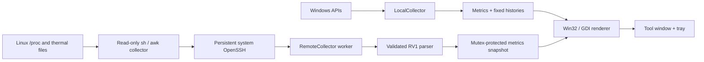

# Architecture and data contract

## Runtime path



The UI thread owns window handles, GDI resources, local metrics and preferences. The worker owns one SSH job and publishes remote state under its mutex. `snapshot()` copies that state under one lock and releases it before painting. SSH reads can block without blocking the message loop. Reconnection uses an interruptible event wait rather than a polling spin.

## Source map

| File | Responsibility |
| --- | --- |
| `src/main.cpp` | Native event loop, drawing primitives, terminal panels, menu, settings, diagnostics and anonymous demo renderer |
| `src/config.*` | Per-user INI persistence, safe defaults, validation and text conversion |
| `src/metrics.*` | Cumulative samples, delta math, fixed ring buffers and read-only Windows adapter |
| `src/remote.*` | OpenSSH child environment, pipes, lifetime job, parser and reconnect loop |
| `src/askpass.cpp` | Single-request credential-to-pipe helper with buffer scrubbing |
| `src/app.rc` / `app.manifest` | Embedded collector, product metadata, DPI awareness and current-user privileges |
| `collectors/linux.sh` | No-install, read-only POSIX collector |
| `tests/metrics_test.cpp` | Deterministic metric/protocol regressions and native collector smoke test |
| `tools/measure.ps1` | Read-only client performance accounting |

Functions, structures, units, ownership and non-obvious control paths are documented in English in the source. The existing interactive labels are primarily Portuguese; terminal metric abbreviations are shared across languages.

## RV1 line format

One ASCII line per sample, terminated by LF:

```text
RV1 total idle memTotal memAvailable swapTotal swapFree diskTotal diskUsed rx tx uptime load temperature
```

| Field | Wire unit / meaning |
| --- | --- |
| `total`, `idle` | Cumulative Linux CPU ticks, excluding duplicated guest time; idle includes iowait |
| `memTotal`, `memAvailable`, `swapTotal`, `swapFree` | KiB from `/proc/meminfo` |
| `diskTotal`, `diskUsed` | KiB for `/` from `df -Pk` |
| `rx`, `tx` | Cumulative interface bytes |
| `uptime` | Boot-relative seconds |
| `load` | One-minute load average |
| `temperature` | Celsius, or `-1` when no readable zone exists |

The receiver enforces a frame-size bound, field count, nonnegative counters, finite floating-point values, coherent totals and KiB multiplication bounds. It parses into temporary state and publishes only complete valid samples. Diagnostics and incomplete input have separate size limits.

## Derived values

```text
CPU % = 100 × (1 − Δidle / Δtotal)
RAM % = 100 × (total − available) / total
Disk % = 100 × used / total
RX/TX bytes/s = Δcounter / client monotonic elapsed seconds
```

Each host has 120-point fixed histories for CPU, RAM, disk, RX and TX. Their capacity spans `120 × interval` seconds. The first sample cannot provide CPU/network deltas; empty history is not filled with invented zeros. Reconnects, reboots, rollback or an invalid time interval reset the timeline. NIC byte rollback yields zero for that direction rather than unsigned underflow.

## Process and resource lifetime

The SSH process starts suspended, is assigned to a kill-on-close job, and only then resumes. Parent-only pipe ends are marked non-inheritable. Closing the app signals cancellation, terminates only its own job and joins the worker before destruction. The GDI backbuffer changes only when dimensions change; pens, brushes, bitmaps, fonts and menus have matching cleanup paths.

The script is embedded as a resource, normalized to LF and streamed to `sh -s` over SSH stdin. It does not create server files, use sudo, install an agent or launch a daemon. Default-route interface selection reduces virtual-bridge double-counting; without a route it falls back to non-loopback counters.

## Diagnostic exports

`--probe` checks real collection; `--window-info` describes the real window styles; `--render-preview` exports live drawing. `--demo-preview` and `--demo-server-preview` instead override every identity and use deterministic synthetic counters without starting SSH. Demo images are layout examples, not benchmark evidence.
