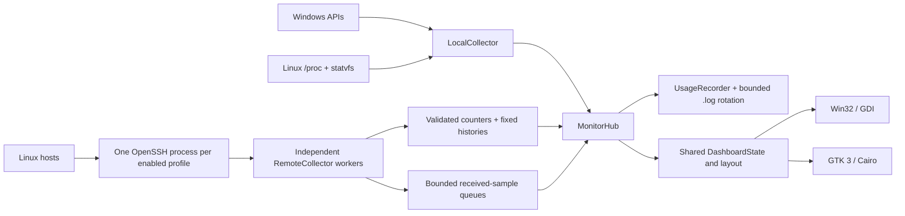

# Architecture — 2.0 development

## Shared model, native frontends



The UI thread owns preferences, local metrics, the hub and the recorder. Each enabled remote profile owns an independent worker, cancellation mechanism and SSH process lifetime. Workers parse into protected state and append received samples to a bounded handoff; they never touch native widgets or log streams.

`snapshot()` copies state under a short collector mutex. Drawing and file I/O occur after that lock is released. `takeSamples()` drains at most 256 raw frames per profile. The hub feeds every drained frame into recording math, so a 100 ms peak is not intentionally replaced by only the final value at a one-second summary boundary. Queue overflow is counted and logged explicitly.

## Profiles and reconfiguration

`ServerProfile` separates identity, monitoring enablement, visibility and collapsed presentation. The maximum is 32 profiles. Native settings operate on a draft; successful Apply persists it atomically and reconfigures the hub.

Unchanged host/user/port/key/interval combinations keep their existing transport and counters. Appearance, aliases and visibility do not force reconnects. Removed/disabled/changed profiles close their old transport and recording state. A hidden but enabled profile still receives samples and log records. Disabling the local-computer option stops that local collector; collapsing its card only affects presentation.

The hub updates process cost once per second, even at 100 ms collection. UI timers continue while a tray-hidden widget has no repaint work. Native windows use the same geometry for card drawing, collapse hit tests and scroll bounds.

## Module map

| Module | Responsibility |
| --- | --- |
| `config.*` | Portable UTF-8 INI schema, v1 migration, bounds, isolated config paths and atomic writes |
| `metrics.*` | Unit-normalized counters, interval math, observed peaks and fixed histories |
| `local_win.cpp` / `local_linux.cpp` | Read-only native OS and current-process counters |
| `remote.cpp` / `remote_linux.cpp` | Persistent SSH transports, scoped process lifetime, bounded parsing and queues |
| `monitor.*` | Fleet orchestration, selective reconfiguration, local sampling and recorder handoff |
| `recording.*` | Duration/continuous sessions, per-window/session peaks, events and rotation |
| `dashboard.*` | Platform-neutral layout and drawing commands |
| `main.cpp` / `settings_win.*` | Win32 widget, dark sectioned settings, diagnostics and native exports |
| `main_linux.cpp` | GTK/Cairo widget, notebook settings, tray hints and headless diagnostics |
| `askpass.cpp` | Windows-only Credential Manager to OpenSSH pipe helper |

## RV1 protocol

The same script is embedded as a Windows resource and configured into a Linux C++ header. It is streamed to `sh -s -- INTERVAL`; no loose collector file is installed on a target.

```text
RV1 total idle memTotal memAvailable swapTotal swapFree diskTotal diskUsed rx tx uptime load temperature
```

| Fields | Wire representation |
| --- | --- |
| `total`, `idle` | Cumulative Linux CPU ticks; guest time is not double-counted and iowait is idle |
| RAM/swap fields | KiB from `/proc/meminfo` |
| Disk fields | KiB for `/` from `df -Pk`, cached for roughly 30 seconds |
| `rx`, `tx` | Cumulative bytes for the default-route interface, with a non-loopback fallback |
| `uptime` | Boot-relative seconds |
| `load` | One-minute Linux load average |
| `temperature` | Celsius or `-1` for unavailable |

Only 0.1, 0.25, 0.5, 1, 2, 5 and 10-second sleep values are accepted. The receiver validates length, exact field count, nonnegative counters, finite floating values, coherent totals and multiplication bounds before converting KiB to bytes. Invalid input never partly overwrites the previous valid sample. Diagnostics and incomplete input have bounded buffers too.

## Derived values and histories

```text
CPU % = 100 × (1 − Δidle / Δtotal)
RAM % = 100 × (total − available) / total
Disk % = 100 × occupied / total
RX/TX bytes/s = Δcounter / monotonic client receive interval
```

Five histories of 120 floats per host bound the chart data. CPU/network rates need two continuous samples. Reconnect/reboot/rollback or an invalid receive interval clears the timeline; NIC counter rollback cannot underflow into a fabricated spike. Local Windows swap/load fields are explicitly unavailable instead of being substituted with Linux semantics.

Renderer columns retain maxima when multiple stored samples map to one narrow column, so downsampling does not deliberately hide a short stored peak. The 120-point history capacity is independent of sampling cadence; a 100 ms configuration spans twelve seconds.

## Native resource and process lifetime

Windows creates SSH suspended, assigns a kill-on-close job, then resumes it. **A `PROC_THREAD_ATTRIBUTE_HANDLE_LIST` allowlist restricts inheritance to that profile's own stdin/stdout handles.** Without the allowlist, concurrent launches can inherit another profile's pipe writer and prevent EOF during shutdown/reconnect. Canceling stops only the owning job, joins the worker and closes its resources.

Linux uses close-on-exec pipes and `posix_spawnp` with a separate process group. The worker polls output with cancellation checks. Shutdown sends TERM, waits briefly, then uses KILL only for its own remaining group if necessary. SIGINT/TERM trigger normal application shutdown. Forced OS/process termination has weaker flushing guarantees than orderly exit.

GDI reuses a backbuffer and stock drawing objects. Cairo reuses one Pango layout within a frame. GTK and GDI own their respective native UI resources; neither calls a browser renderer. Linux utility/skip-taskbar/keep-above behavior is a compositor hint, especially under Wayland.

## Recording boundaries

The recorder is UI/hub-thread-owned, uses monotonic deadlines and writes UTC timestamps. Latest values and window/session peaks are separate. Peak times refer to receipt of the contributing frame; write times can be later. Summaries are not emitted faster than new measurements arrive. Normal flushing occurs at least once a second; forced termination can lose buffered lines.

One active file plus a configurable number of size-limited archives bounds disk retention. Recording configuration changes begin a new session; ordinary appearance changes preserve it. Profile removal emits a final summary and releases its retained state. See [recording details](RECORDING.md).

## Verification

The common tests cover protocol math, bounded histories, schema migration, independent profiles, finite/continuous recording, peak retention and size rotation. Linux process tests use an isolated fake `ssh` in a test-only PATH to verify concurrent transports, hidden-node logs, preserved sessions and sample queues without credentials. GTK smoke tests construct actual native windows and apply the settings form under Xvfb. Windows live validation uses two real independent SSH sessions, not the fixture.

Anonymous exports override identities before drawing and never launch SSH. They are separate from the real-client performance reports and private local test configurations.
